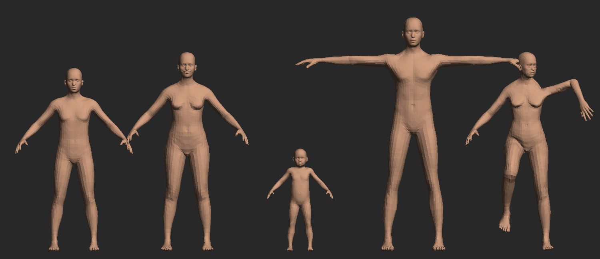

# anny-maya

[NAVER's **Anny**](https://github.com/naver/anny) parametric human **body**
model inside Autodesk Maya — any age, gender and build from one mesh and one
skeleton, with live sliders, the 52 ARKit face shapes, posing, and a one-click
bake to a plain Maya rig (joints + skinCluster + blendShapes) for animation
and FBX export.



Anny ([paper](https://arxiv.org/abs/2511.03589)) is built on the CC0
MakeHuman/MPFB2 assets: phenotypes (gender, age, muscle, weight, height,
proportions…) interpolate MakeHuman "macro" blend shapes, 250+ local changes
shape individual regions, Face Units provide the 52 ARKit facial actions, and
a 104-bone rig deforms the mesh with linear blend skinning. Sibling project of
[gnm-maya](https://github.com/enriquevelmai/gnm-maya) (heads).

## How it's contained

- **No PyTorch.** Anny's evaluation is **ported to numpy**
  (`anny-maya/external/_anny_core.py`) and **validated vertex-for-vertex
  against the official package** (see *Validation*). The precomputed rig
  cache `anny.pth` is read with a torch-free, restricted unpickler.
- The model runs in the module's **own Python runtime** (`runtime/`;
  Windows: portable CPython 3.11 — no Python install needed; Linux/macOS: a
  venv built from your `python3`). Its only package is numpy.
- A **resident worker** (`external/server.py`) keeps the model loaded; each
  slider edit is ~20 ms of evaluation, ~35 ms end-to-end including the mesh
  update. Maya reads small binary vertex files with a pure-Python reader.
- **Anny's data is never committed here.** On first run it is downloaded
  from the naver/anny commit pinned in `external/ANNY_DATA.json` (v0.6.1, by
  exact SHA), only the needed asset folders are extracted, and they are
  compiled once (~10 s) into a fast-loading cache.
- **Commercial-use clean:** only Apache-2.0 code and CC0 assets. No SMPL /
  SMPL-X topology, no `anny[smpl]` extras, nothing non-commercial.

```
drag_and_drop_install.py   <- drag into Maya to install
ANNY.mod                   <- module descriptor (manual install)
anny-maya/                 <- the Maya module
  scripts/userSetup.py     <- adds the "Anny" menu on launch
  scripts/anny_maya/       <- Maya-side package (pure python, no numpy)
  external/                <- numpy port + worker (run in runtime/)
    anny_data/             <- NAVER Anny assets (downloaded on first run)
  runtime/                 <- module's own Python (set up on first run)
  tests/                   <- validation vs official Anny, GUI smoke test
  build_module.py          <- dev: first-run setup without Maya
```

## Install (Windows / Linux / macOS, Maya 2022–2027)

1. Download this repo (Code ▸ Download ZIP) and extract it anywhere.
2. Drag `drag_and_drop_install.py` into a running Maya viewport.

It **copies the module into `~/Documents/maya/modules/anny-maya`**, registers
it, adds the **Anny** menu + shelf button, and runs the **first-run setup**
(portable Python + numpy ~30 MB, Anny assets ~48 MB download, one-time
compile). Afterwards you can delete the zip and the extracted folder;
everything runs offline.

Manual alternative: copy `ANNY.mod` and the `anny-maya/` folder into
`~/Documents/maya/modules/` and restart Maya; opening the panel offers the
same setup. Linux needs `python3` with `venv` (`sudo apt install
python3-venv`); macOS needs `python3` (Maya's `mayapy` is the fallback).

## Use

**Anny ▸ Anny Body Panel…** opens the panel on the selected (or any) Anny
body, or creates one, and frames it in every viewport. Native Maya widgets
only; hover any control for a short titled tooltip; double-click a slider to
reset it. Tabs:

- **Create** — the phenotypes: Gender (0 male … 1 female), Age (−0.33
  newborn, 0 baby, 0.33 child, 0.67 young adult, 1 old), Muscle, Weight,
  Height, Proportions; *More phenotypes* (collapsed): cup size, firmness and
  the three ancestry blend weights. **Randomize** draws a plausible adult
  (*Children* allows any age, *All phenotypes* rolls the extra ones too).
  **New Body** adds another body.
- **Body** — 254 MakeHuman local changes (−1…1) in collapsible regions
  (head, nose, mouth, torso, arms, legs, measurements…), with a **filter**
  box and per-region **Randomize/Reset** (amount adjustable).
- **Face** — the 52 **ARKit facial actions** (eyeBlinkLeft, jawOpen,
  mouthSmileLeft…, 0…1) grouped by brows / eyes / cheeks & nose / jaw /
  mouth / tongue, plus quick expressions (Smile, Surprise, Anger, Sadness,
  Blink, Open mouth) and Randomize.
- **Pose** — the 104-bone `anny` rig as a bone tree; rotate the selected
  bone about Maya's world X/Y/Z axes at the neutral pose (Anny's
  `local-ref` parameterization), root position, **Neutral / T-Pose / Arms
  Down** presets (aimed for the current body's proportions), Mirror L→R /
  R→L.
- **Animate** — **Bake Rig**: a new mesh with the 104 joints (Anny's rest
  frames), a skinCluster with Anny's own weights (classic linear = Anny's
  LBS, so it matches the panel to ~1e-5 cm) and a blendShape with the 52
  ARKit targets, posed and expressed like the panel. No Anny runtime needed.
  **Export Rig (FBX)…**, **Static Copy**, and rig tools (bind pose, copy the
  panel pose onto a rig).

Around the tabs: **Symmetry** (mirrors L/R edits in Body, Face and Pose),
the **◀ ▶ history** of looks, **Display** (hide eyes/tongue, skin colour,
frame) and **Reset All**. The body's state is stored on its transform
(`annyState`), so re-opening the panel restores every slider.

Materials are Maya's native **standardSurface** (skin / eyes / tongue) —
Arnold renders them, and Maya's vertex-colour tools keep working.

From script:

```python
import anny_maya
body = anny_maya.create_body(randomize=False)   # live AnnyBody controller
body.set_phenotype("age", 0.9)
body.set_local("nose-scale-vert-incr", 0.5, symmetry=True)
body.set_face("jawOpen", 0.6)
body.set_rotation("upperarm01.L", 2, 45.0, symmetry=True)  # Z, degrees
body.pose_preset("tpose")
state = body.get_state()            # JSON-friendly; body.set_state(state)

from anny_maya.scene import rig
rig.bake_rig(body)                   # joints + skinCluster + 52 blendShapes
```

## Validation

The numpy port is checked against the official `anny` package (v0.6.1 +
torch CPU, installed only in a **dev-only venv** that is gitignored and never
shipped):

```
python -m venv .devvenv
.devvenv/Scripts/pip install torch --index-url https://download.pytorch.org/whl/cpu
SETUPTOOLS_SCM_PRETEND_VERSION=0.6.1 .devvenv/Scripts/pip install "anny @ https://github.com/naver/anny/archive/d6fc027ced5c17b6b0775dee944096ade7a9ef80.zip"
.devvenv/Scripts/python anny-maya/tests/validate_vs_official.py all
```

`generate` evaluates the official model on 75 seeded random cases
(phenotypes incl. extremes and the extra phenotypes, local changes, facial
actions, small and fully random poses on all 104 bones) and writes fixtures;
`check` (numpy only — also runs in the module's own runtime) rebuilds the
model from the downloaded assets and compares everything. v1.0.0 result:

| quantity | max abs error |
|---|---|
| template vertices / skin weights | 1.7e-16 / 4.4e-16 |
| faces, UV indices, labels, bone order | identical |
| blend shape coefficients | 1.1e-16 |
| rest vertices / rest skeleton | 1.6e-15 m / 6.1e-15 |
| posed bones / **posed vertices** | 1.6e-15 / **2.3e-15 m** |

In Maya, `smoke_test.run_headless()` (mayapy) builds a body, drives every
parameter family, bakes a rig and checks the rig reproduces the worker's
mesh (max error 1.5e-5 cm, float32), exports FBX and builds the real panel
headlessly — passing on Maya 2022, 2024, 2025, 2026 and 2027.

## Updating

**Anny ▸ Check for Updates…** (also checked quietly when the panel opens)
downloads this tool by exact tag/commit, replaces `scripts/` and `tests/`
(with an in-place overlay when Windows locks the loaded package) and reloads
the package — no Maya restart needed. Two channels: **Releases** (default)
and **Dev** (latest `main` commit). `runtime/` and `anny_data/` are never
touched; if a release pins a newer Anny commit, the data is re-downloaded on
the next panel open.

## Roadmap

Phase 2: attach a [GNM](https://github.com/enriquevelmai/gnm-maya) head to
the Anny body (align to the `head` joint, hide Anny's head by mask, stitch
the neck).

## Credits & licensing

anny-maya is Apache-2.0. It downloads and uses **Anny** © 2025 NAVER Corp.
(Apache-2.0; `_anny_core.py` is a numpy port of its code), the
**MakeHuman / MPFB2** assets (CC0) and the **Face Units** pack by Mika
Suominen (CC0). See [`anny-maya/NOTICE.md`](anny-maya/NOTICE.md) and
**Anny ▸ Licenses…**. Not affiliated with NAVER or MakeHuman. If you use
Anny in research, please cite the
[Anny paper](https://arxiv.org/abs/2511.03589).
